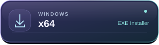

# دانلود Tunila

لینک اشتراکت را اضافه کن، سرورت را انتخاب کن و وصل شو.

[تغییرات اندروید ۰٫۷٫۳۹](https://github.com/SevinEW/Tunila-Releases/releases/tag/v0.7.39-beta.1) · [راهنمای نصب](SUPPORT.md) · [گزارش مشکل](https://github.com/SevinEW/Tunila-Releases/issues)

## فایل مناسب دستگاهت

<table>
<tr><th align="right">سیستم‌عامل</th><th align="center">دانلود مستقیم</th><th align="right">مناسب برای</th></tr>
<tr><td rowspan="3"><strong>Android</strong> ۰٫۷٫۳۹ بتا · اندروید ۸ به بالا</td><td align="center"></td><td><strong>بیشتر گوشی‌های جدید</strong> اندروید ۶۴ بیتی · انتخاب پیشنهادی</td></tr>
<tr><td align="center"></td><td>دستگاه‌های دارای اندروید ۳۲ بیتی</td></tr>
<tr><td align="center"></td><td>شبیه‌سازها و دستگاه‌های سازگار با x86_64</td></tr>
<tr><td><strong>Windows</strong> ۰٫۷٫۲۶ بتا · نسخهٔ قدیمی</td><td align="center"></td><td>ویندوز x64 <strong>نسخهٔ جدید ویندوز هنوز در انتشار عمومی قرار نگرفته است.</strong></td></tr>
</table>

**برای آپدیت، برنامهٔ قبلی را حذف نکن.** فایل مناسب دستگاهت را دریافت و روی نسخهٔ رسمی قبلی نصب کن.

دانلود APK کامل نمی‌شود؟

[دانلود جایگزین ARM64 به‌صورت ZIP](https://github.com/SevinEW/Tunila-Releases/releases/download/v0.7.39-beta.1/Tunila-0.7.39-beta.1-android-arm64.zip) — فایل را استخراج کن و APK داخل آن را نصب کن. این فایل همان APK رسمی است.

[بررسی صحت فایل‌های اندروید](https://github.com/SevinEW/Tunila-Releases/releases/download/v0.7.39-beta.1/SHA256SUMS-Android.txt) · [نسخه‌های پیشین](https://github.com/SevinEW/Tunila-Releases/releases)

## شروع سریع

۱. نسخهٔ مناسب دستگاهت را نصب کن.  
۲. در برنامه «افزودن» را بزن و لینک اشتراکت را وارد کن.  
۳. یک سرور یا «انتخاب سریع‌ترین» را انتخاب کن و وصل شو.

## تغییرات اندروید ۰٫۷٫۳۹

- جدا شدن زمان راه‌اندازی اتصال از اندازه‌گیری پینگ.
- پخش انیمیشن آغازین فقط در شروع برنامه.
- حذف همهٔ کانفیگ‌های دیفالت با تأیید کاربر.
- اصلاح حاشیهٔ تب‌ها، سربرگ پنجره‌ها و انتخاب ناخواستهٔ متن.
- توقف فعالیت‌های تصویری در پس‌زمینه و سبک‌تر شدن جلوه‌ها روی دستگاه‌های کم‌توان.

وضعیت آزمون و سازگاری

این نسخه بتاست. ساخت، بررسی بسته و تست اشتراک اندروید موفق بود؛ آزمون کامل اتصال به‌دلیل توقف شبیه‌ساز تکمیل نشد.

نسخهٔ ویندوز در جدول، نسخهٔ قدیمی ۰٫۷٫۲۶ است. برای iOS، macOS و Linux در این صفحه فایل نصبی ارائه نمی‌شود.

با قطع تونل، اینترنت مستقیم در دسترس قرار می‌گیرد؛ این نسخه کیل‌سوییچ دائمی ندارد.

## پشتیبانی

[راهنمای نصب](SUPPORT.md) · [حریم خصوصی](SECURITY.md) · [ثبت مشکل](https://github.com/SevinEW/Tunila-Releases/issues)

هنگام گزارش مشکل، نسخهٔ برنامه و سیستم‌عامل را بنویس. **لینک ساب، رمز و کلید خصوصی را منتشر نکن.**

این مخزن فقط فایل نصب و راهنما را منتشر می‌کند؛ کد اختصاصی Tunila خصوصی است. [مجوزها](LICENSE.txt)

