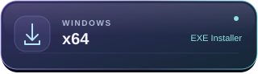

  

# تونیلا

لینک اشتراکت را اضافه کن، سرورت را انتخاب کن و وصل شو.

**[دانلود و جزئیات نسخهٔ جدید](https://github.com/SevinEW/Tunila-Releases/releases/tag/v0.7.24-beta.1)** · [راهنمای استفاده](SUPPORT.md) · [گزارش مشکل](https://github.com/SevinEW/Tunila-Releases/issues)

## دانلود نسخهٔ ۰٫۷٫۲۴ بتا

سیستم‌عاملت را انتخاب کن. دکمه‌های زیر مستقیماً فایل نصب را دانلود می‌کنند.

<table>
<tr><th align="right">سیستم‌عامل</th><th align="center">فایل نصب</th><th align="right">کدام را انتخاب کنم؟</th></tr>
<tr><td><strong>Android</strong> اندروید ۸ و بالاتر ۰٫۷٫۲۴ بتا · APK امضاشده</td><td align="center">
 
 

</td><td><strong>ARM64</strong>: بیشتر گوشی‌های جدید؛ از جمله Galaxy S25 Ultra.  <strong>ARMv7</strong>: گوشی با اندروید ۳۲ بیتی.  <strong>x86_64</strong>: شبیه‌ساز یا دستگاه با این معماری.</td></tr>
<tr><td><strong>Windows</strong> نسخهٔ ۶۴ بیتی ۰٫۷٫۲۴ بتا · نصب‌کنندهٔ EXE</td><td align="center">

</td><td>برای کامپیوتر با ویندوز x64. نصب‌کننده فعلاً گواهی تجاری ندارد. Windows x86 و ARM64 در این نسخه به‌روز نشده‌اند.</td></tr>
</table>

**ارتقای اندروید:** فایل جدید را روی نسخهٔ قبلی نصب کن؛ نیازی به حذف برنامه نیست. امضای انتشار و شناسهٔ برنامه حفظ شده‌اند.

[تغییرات و نتیجهٔ آزمون‌ها](https://github.com/SevinEW/Tunila-Releases/releases/tag/v0.7.24-beta.1) · [بررسی صحت دانلود — SHA256SUMS](https://github.com/SevinEW/Tunila-Releases/releases/download/v0.7.24-beta.1/SHA256SUMS) · [راهنمای معماری‌ها](DOWNLOADS.md)

> این نسخه برای تست است. چهار آزمون اجرایی روی شبیه‌ساز اندروید ۱۴ موفق بوده‌اند؛ سازگاری همهٔ گوشی‌ها، شبکه‌ها و پروتکل‌ها هنوز تأیید نشده است. جزئیات محدودیت‌ها در صفحهٔ انتشار آمده است.

## شروع استفاده

1. برنامه را نصب کن و «افزودن» را بزن.
2. لینک اشتراک را وارد کن و برایش نام بگذار.
3. سرور دلخواه یا «انتخاب سریع‌ترین» را انتخاب کن و متصل شو.

هر اشتراک لیست خودش را دارد. کانفیگ‌های تکی در «دیفالت» می‌مانند.

اندروید ۸ یا بالاتر و Android System WebView به‌روز لازم است. مجوز VPN خود اندروید هنگام اولین اتصال نمایش داده می‌شود. [امکانات و محدودهٔ نسخهٔ اندروید](https://github.com/SevinEW/Tunila-Releases/releases/tag/v0.7.24-beta.1)

## امکانات نسخهٔ ویندوز

- **اشتراک‌ها:** به‌روزرسانی، ویرایش، حذف و اشتراک‌گذاری با لینک یا QR.
- **سرورها:** بررسی تأخیر، انتخاب سریع‌ترین و یادآوری آخرین سرور متصل‌شده.
- **اتصال:** TUN سراسری؛ تنظیمات پیشرفته در بخش‌های جداگانه.
- **کانفیگ‌ها:** Xray، Hysteria2 و WireGuard، با تنظیمات انتقال و گواهی‌ها.

سازگاری هر کانفیگ به پروتکل، تنظیمات و سرور آن بستگی دارد.

## پشتیبانی

برای [گزارش مشکل](https://github.com/SevinEW/Tunila-Releases/issues)، نسخهٔ برنامه و سیستم‌عامل، مراحل تکرار و متن خطا را بنویس. **لینک ساب، رمز و کلید خصوصی را نفرست.**

[نصب و رفع اشکال](SUPPORT.md) · [حریم خصوصی و امنیت](SECURITY.md)

دربارهٔ نسخهٔ آزمایشی

نسخهٔ آزمایشی اندروید و ساخت‌های اولیهٔ Windows x86 و ARM64 نیز منتشر شده‌اند. وضعیت آزمون هر بسته را در [صفحهٔ نسخه‌ها](DOWNLOADS.md) بخوان.

آزمون نصب و اتصال روی سیستم‌های هدف هنوز کامل نشده است. این نسخه کیل‌سوییچ دائمی ندارد؛ با قطع تونل، اینترنت مستقیم در دسترس قرار می‌گیرد.

فایل SHA256 کنار نصب‌کننده برای بررسی صحت دانلود است و جای امضای دیجیتال ناشر را نمی‌گیرد.

---

این مخزن فقط برای دانلود و راهنماست. کد اختصاصی Tunila عمومی نیست. مجوز اجزای شخص ثالث و منبع هستهٔ اصلاح‌شده همراه بسته ارائه می‌شوند. [حقوق نرم‌افزار](LICENSE.txt)

