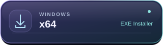

# دانلود Tunila

## [ورود به صفحهٔ دانلود ↗](https://sevinew.github.io/Tunila-Releases/)

لینک اشتراکت را اضافه کن، سرورت را انتخاب کن و وصل شو.

[تغییرات اندروید ۰٫۷٫۴۶](https://github.com/SevinEW/Tunila-Releases/releases/tag/v0.7.46-beta.1) · [راهنمای نصب](SUPPORT.md) · [گزارش مشکل](https://github.com/SevinEW/Tunila-Releases/issues)

## فایل مناسب دستگاهت

<table>
<tr><th align="right">سیستم‌عامل</th><th align="center">دانلود مستقیم</th><th align="right">مناسب برای</th></tr>
<tr><td rowspan="3"><strong>Android</strong> ۰٫۷٫۴۶ بتا · اندروید ۸ به بالا</td><td align="center"></td><td><strong>بیشتر گوشی‌های جدید</strong> اندروید ۶۴ بیتی · انتخاب پیشنهادی</td></tr>
<tr><td align="center"></td><td>دستگاه‌های دارای اندروید ۳۲ بیتی</td></tr>
<tr><td align="center"></td><td>شبیه‌سازها و دستگاه‌های سازگار با x86_64</td></tr>
<tr><td><strong>Windows</strong> ۰٫۷٫۴۶ بتا · Windows 10 / 11</td><td align="center"></td><td>ویندوز x64 پردازنده‌های Intel و AMD</td></tr>
</table>

**برای آپدیت، برنامهٔ قبلی را حذف نکن.** فایل مناسب دستگاهت را دریافت و روی نسخهٔ رسمی قبلی نصب کن.

[بررسی صحت فایل‌های اندروید](https://github.com/SevinEW/Tunila-Releases/releases/download/v0.7.46-beta.1/SHA256SUMS-Android.txt) · [نسخه‌های پیشین](https://github.com/SevinEW/Tunila-Releases/releases)

## شروع سریع

۱. نسخهٔ مناسب دستگاهت را نصب کن.  
۲. در برنامه «افزودن» را بزن و لینک اشتراکت را وارد کن.  
۳. یک سرور یا «انتخاب سریع‌ترین» را انتخاب کن و وصل شو.

## تغییرات اندروید ۰٫۷٫۴۶

- اصلاح مسیر DNS برای سرورهایی که خروجی IPv6 سالم ندارند.
- حفظ نام دامنهٔ مقصد برای سازگاری اتصال با مسیریابی سرور.
- اصلاح ورود کانفیگ VLESS HTTPUpgrade و دریافت دادهٔ آن.
- تشخیص خودکار نوع لینک و بررسی دوبارهٔ کانفیگ‌های قبلاً مسدودشده.

وضعیت آزمون و سازگاری

این نسخه بتاست. ساخت، بررسی امضای هر سه APK و آزمون‌های اشتراک، تونل TCP/UDP، بازیابی اتصال و تعویض سرور در شبیه‌ساز اندروید موفق بودند. تست صفحات چند سرویس از جمله Google Search نیز با یک سرور آزمایشی انجام شد؛ سازگاری همهٔ گوشی‌ها و شبکه‌ها هنوز تضمین نمی‌شود.

نسخهٔ ویندوز ۰٫۷٫۴۶ ساخته شده و ۴۰ بررسی ضروری را گذرانده است؛ تست اتصال واقعی آن روی دستگاه کاربر هنوز تأیید نشده است. برای iOS، macOS و Linux در این صفحه فایل نصبی ارائه نمی‌شود.

با قطع تونل، اینترنت مستقیم در دسترس قرار می‌گیرد؛ این نسخه کیل‌سوییچ دائمی ندارد.

## پشتیبانی

[راهنمای نصب](SUPPORT.md) · [حریم خصوصی](SECURITY.md) · [ثبت مشکل](https://github.com/SevinEW/Tunila-Releases/issues)

هنگام گزارش مشکل، نسخهٔ برنامه و سیستم‌عامل را بنویس. **لینک ساب، رمز و کلید خصوصی را منتشر نکن.**

این مخزن فقط فایل نصب و راهنما را منتشر می‌کند؛ کد اختصاصی Tunila خصوصی است. [مجوزها](LICENSE.txt)

